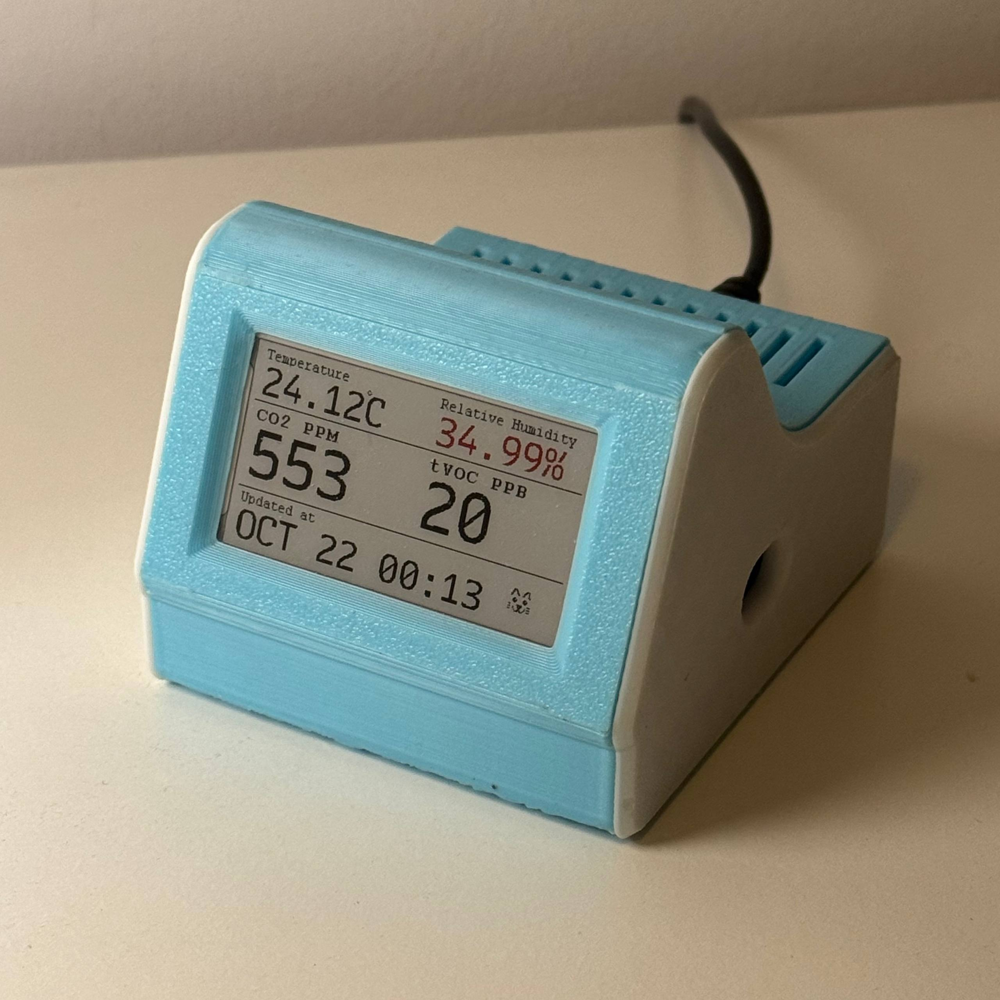
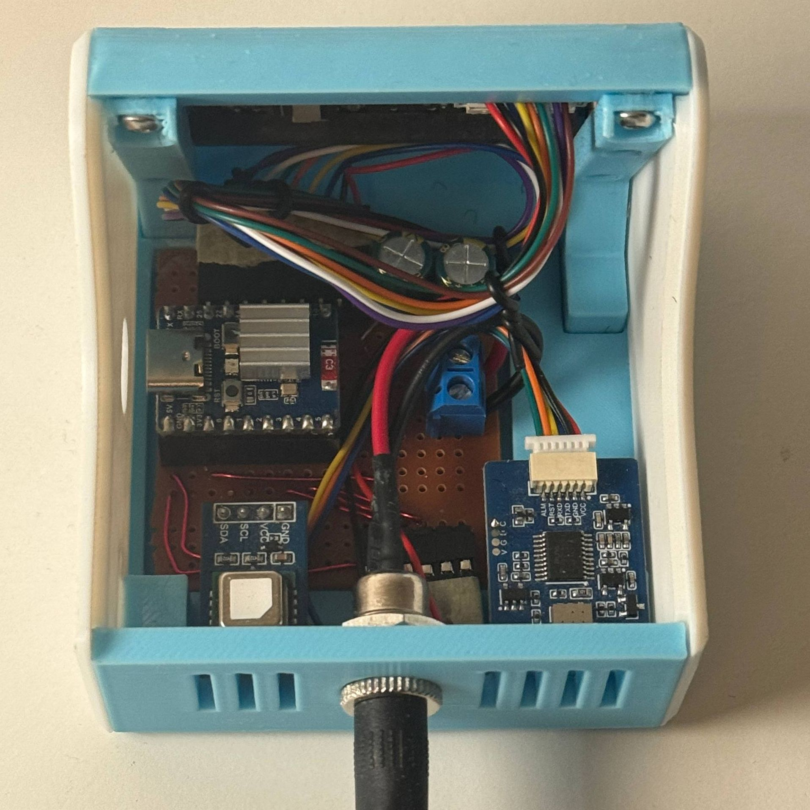

# Air Monitor

<p>
  
  
</p>

ESP-IDF firmware for an ESP32-H2 based **Zigbee air quality monitor**

- **Waveshare TVOC Gas Sensor** (UART): TVOC https://www.waveshare.com/tvoc-sensor.htm
- **Sensirion SCD41** (I2C): CO2, temperature, humidity https://sensirion.com/products/catalog/SCD41
- **2.15" e-paper display** (Waveshare EPD_2in15g): local readout https://www.waveshare.com/2.15inch-e-paper-hat-plus-g.htm
- **Zigbee end device** (esp-zigbee-lib 2.x on ESP-IDF v6): https://www.waveshare.com/esp32-h2-zero.htm


## Hardware

Waveshare **ESP32-H2-Zero** (ESP32-H2FH4, 4 MB flash, single-core 96 MHz, 802.15.4 + BLE).

### Pinout

| Peripheral | Interface / pins |
|------------|------------------|
| WS2812 RGB LED | GPIO8, onboard |
| Boot button | GPIO9, onboard |
| TVOC sensor | UART1 @115200: TX-GPIO4, RX-GPIO5, RST-GPIO3 (ALM unused) |
| SCD41 (CO2/temp/humidity) | I2C0: SDA-GPIO0, SCL-GPIO1 |
| 2.15" e-paper (EPD_2in15g, red/yellow/black/white) | SPI: DIN-10, CLK-11, CS-12, DC-13, RST-14, BUSY-22, PWR-25 |

### Button functions

| Action | GPIO9 (BOOT) |
|--------|----------------|
| Short press | Force display refresh |
| Long press (≥5s) | Factory reset |

### Enclosure

CAD files for a 3D-printed enclosure are available [here](https://cad.onshape.com/documents/c97e2b61012092e841a9b4d5/w/ea7ecf13b175233d7b5ebe80/e/7d9fb59e59b98783d4c40523?renderMode=0&uiState=6ad98e6d22f1cf04ba894b2c). Check the assembly for installation instructions. A 5V Power supply is required, alternatively, power the device via USB-C on the ESP32-H2-Zero board.

<p>
  
  
</p>

## Usage

### Connection

After flashing / booting, the device will start advertising as a Zigbee end device. Use a Zigbee coordinator (e.g. Home Assistant with ZHA) to pair it.

### Zigbee Quirk

The device implements a custom ZHA quirk. See `zigpy/zhaquirk.py` for details.

### Calibration

To calibrate the temperature offset, use the following formula:

$$
\Delta_{\text{new}} = \Delta_{\text{old}} + t_{\text{reported}} - t_{\text{reference}}
$$

where:

- $\Delta_{\text{new}}$ is the new offset to write to the SCD41
- $\Delta_{\text{old}}$ is the previous offset
- $t_{\text{reported}}$ is the temperature reported by the SCD41
- $t_{\text{reference}}$ is the temperature measured by a reference thermometer


## Layout

```
├── main/                  orchestrator (tasks, shared state, SCD41 usage)
├── components/
│   ├── epaper/            e-paper driver + GUI + fonts
│   ├── led/               WS2812 driver + thread-safe LED controller
│   ├── tvoc/              UART TVOC sensor driver
│   └── zigbee/            Zigbee end device (owns esp-zigbee-lib dependency)
├── zigpy/zhaquirk.py      ZHA quirk for Home Assistant
├── docs/                  committed reference docs (TVOC sensor protocol)
├── scripts/               font / LUT / UI helper scripts
├── partitions.csv         custom partition table (zb_storage/zb_fct for Zigbee)
└── sdkconfig.defaults     checked-in build configuration
```

## Build

Requires **ESP-IDF v6.0.1**, target `esp32h2`:

```bash
idf.py set-target esp32h2
idf.py build
idf.py flash monitor
```
